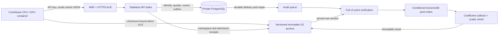

# ECC Challenges

A public, distributed Pollard rho search on the
[Certicom ECC challenges](https://www.certicom.com/content/dam/certicom/images/pdfs/challenge-2009.pdf).
Sign in at **[ecc-challenges.com](https://ecc-challenges.com)**, create an API
key, and run one Docker container on a CPU or NVIDIA GPU, or the native worker on a
Mac (Metal) or a Windows PC. Your worker sends back
distinguished points; the server checks them and looks for a collision.

- **Run a worker:** [Running a worker](docs/running-a-worker.md) covers Docker,
  Compose, Kubernetes, systemd, Podman, Slurm/Apptainer, Modal, macOS and
  Windows, on GPU (CUDA, Metal) or CPU (x86-64 and arm64).
- **Work on the code:** read [CONTRIBUTING.md](CONTRIBUTING.md) and the
  [open problems](problems/README.md). The [local stack](docs/local-stack.md)
  runs the whole platform on one machine.
- **Live numbers:** [status page](https://ecc-challenges.com/status) and
  [`/v1/status`](https://ecc-challenges.com/v1/status).

## How the gateway is built

`ecc-challenges.com` is the distributed contribution gateway for the 24 published
Certicom ECC challenges. Contributors sign in with GitHub, generate a revocable
API key, and run a pinned Linux container on a workstation or cloud provider.
The generic v2 worker supports prime and binary fields through 359 bits, with
CPU, NVIDIA CUDA and Apple Metal backends that share one arithmetic core
(`worker/generic/ec_core.h`), on Linux, macOS and Windows. Existing ECC2K-130 v1 state keeps its original
Frobenius walk and 32-byte record format.

Release status, 19 October 2026: all 24 curves are enabled on the public gateway.
The final CPU image passed all-curve checks natively on amd64 and arm64; the
final combined CPU/CUDA image passed 336 checks on a RunPod RTX 4090. Bounded live
CPU checks passed registration, independently checked checkpoint witnesses,
same-run restart and closure on every curve. Short runs emitted production
points on ECC2-79 and ECCp-79; these checks do not establish larger-curve point
rates or fleet capacity. All validation pods were terminated. See the
[release receipts](verification/hardware-20261019/README.md) and
[earlier correctness controls](verification/all-curves-20261016/README.md).

Both public packages are linked to this repository:

| Image | Hardware |
| --- | --- |
| `ghcr.io/aburan28/ecc-challenges-worker:latest` | Linux amd64 CPU or NVIDIA CUDA |
| `ghcr.io/aburan28/ecc-challenges-worker-cpu:latest` | Linux amd64 and arm64 CPU |

Each image supports all 24 curves. The dashboard provides immutable image
digests and each challenge's worker command. FPGA acceleration is deferred.

V2 uploads immutable checksum-bound batches directly to versioned S3, verifies
every point relation, and conditionally indexes exact points in DynamoDB.
PostgreSQL holds identity, quotas, admission cursors and processing metadata.
See the [all-curve storage design](docs/multicurve-storage.md) for namespace
binding, sizing, collision safety, compaction and archive reconstruction.



This diagram describes v2. The separate legacy ECC2K-130 protocol retains its
sampled trail replay and PostgreSQL candidate projection. Historical points are imported
one way by `scripts/historical_import.py` (see [operations](docs/operations.md#historical-point-import));
new generic points have their own curve/walk namespaces.

## Contribute

1. Open `https://ecc-challenges.com`, sign in with GitHub, and create an API key.
   The complete key appears once. Save it in
   `~/.config/ecc-challenges/api-key` with mode `0600`.
2. Set `GPU_ID` to the device index for this container and create a persistent
   local data directory for it. Give each GPU a distinct directory; never
   restart a run with a fresh directory while its earlier seed range is active.
3. Run the command shown on the dashboard. On Linux, install the NVIDIA
   Container Toolkit so Docker's `--gpus all` can expose the card. The worker
   keeps its run identity and checkpoint in the mounted data directory.

For other environments (CPU-only, Kubernetes, systemd, Podman, Slurm) see
[Running a worker](docs/running-a-worker.md). For an RTX PRO 6000 Blackwell
worker in your own Modal account, follow the
[Modal worker guide](docs/modal-workers.md). Start with one bounded worker and
check its registration, upload, replay, and index status before adding more.

The container pauses GPU collection when the local upload spool reaches its
limit and retries with the same run ID. A server `429` or `503` is a request to
back off, not permission to discard the local file. Revoking the key stops
uploads for its runs. A key is not an AWS credential: it grants no bucket
listing, archive reads or database access. A signed upload capability permits
only its exact bounded object write.

## What an accepted upload means

For v2, admission checks key/account limits, UUID ownership, namespace, cursor,
record alignment and checksum-bound S3 object metadata. Its ACK means the
versioned raw bytes and admission receipt are durable. The audit worker then
checks **every** record's DP predicate, curve equation and `R=aG+bQ` relation
before any DynamoDB insertion. A collision rechecks its source receipts and
coefficient witnesses, computes the candidate scalar and checks `dG=Q`.
Verified coefficient relations do not attest reported trail lengths, so the
site's work and completion figures are estimates from point counts
([docs/campaigns.md](docs/campaigns.md)), not verified work.

The separate legacy ECC2K-130 sigma protocol accepts DP30, DP32 and DP34.
The NVIDIA dashboard recommends DP34 for new runs; existing runs retain their
threshold. See [threshold selection](docs/running-a-worker.md#ecc2k-130-legacy-sigma-thresholds).

The API checks framing, run ID, canonical orbit-key shape at the run's threshold, body size,
cursor, key status, key rate and quota, and global pending capacity. It stores
the exact bytes under a checksum-bound, write-once S3 key. A successful upload
acknowledges archival and the committed cursor. It does **not** assert that
each record came from the claimed seed.

The first batch of each run is selected for independent replay. Later batches
are selected after sealing with probability 1/128. A passing first replay
opens indexing for that run; sampled and unselected states remain distinct.
All public points are kept in `ecc_public.candidate_points`, separate from the
existing campaign's authoritative table. A failed later replay suspends the
run, revokes its key, disqualifies already indexed candidate points, and
quarantines its leads. A collision lead triggers exact replay of both trails
and a pinned host solver; a separate golden-model multiplication must also
check the reported scalar against the challenge points before a lead is
marked verified.

These checks contain abuse and preserve evidence, but sparse random sampling
cannot certify every point in a batch. Quotas, queue backpressure, operator
monitoring, and exact replay of every collision lead remain essential.

## Development

```sh
uv sync --extra test
# Needs PostgreSQL 16 binaries on PATH (initdb, pg_ctl), or set TEST_POSTGRES_DSN.
# macOS: PATH=/opt/homebrew/opt/postgresql@16/bin:$PATH
uv run python -m pytest -q
aws cloudformation validate-template --template-body file://infra/foundation.yaml
aws cloudformation validate-template --template-body file://infra/data.yaml
aws cloudformation validate-template --template-body file://infra/service.yaml
```

The integration suite starts isolated PostgreSQL and mocked S3/SQS. It checks
key lifecycle, run assignment, upload idempotency, archival, outbox repair,
indexing, failed replay quarantine, and the HTTP worker protocol. The audit
image builds and runs the pinned arithmetic test before copying the replay
binary; its host solver is separately built from a pinned `crypto` source
commit. Source bundles and hashes are under `vendor/`.

## Deployment and capacity

See [operations](docs/operations.md) for image publishing, AWS stacks,
Squarespace DNS, GitHub OAuth setup, rollout checks, and queue alarms. See
[admission and capacity](docs/admission-and-capacity.md) for the threat model,
rate limits, and the measurable throughput gate. The capacity script accepts
observed rates:

```sh
python3 scripts/capacity.py --gpus 1000 --steps-per-gpu-second 1000000000 \
  --steps-per-dp 350000000 --index-rows-per-task-second 20000 \
  --audit-seconds-per-record 600 --new-runs-per-hour 100
```

The numbers in that command are **illustrative input**, not campaign
measurements. Releasing the site to a large fleet requires measured replay
time and a sustained arrival/drain test; this is tracked in
[the capacity problem record](problems/dp32-verifier-and-ingest-capacity.md).

## Source and campaign boundary

The contributor GPU base is the immutable image
`ghcr.io/aburan28/ecc2k130-worker@sha256:25299db686c6b73bb59edc1b5f6591d917ada4e5d933172a4eca7274a71e9421`.
The replay source is `aburan28/cryptanalysis` commit
`c8cc56d8c98705c7f84a21aae1e042453e0105e6`; the scalar resolver source
is `aburan28/crypto` commit
`79006eb85a400474e83f6a76fac0dca6b60a8b5d`.
The isolated S3 seed registry is the admission authority for public run IDs.
The original campaign table remains in its own account and is never written
by this service. Until its points are imported and backmatched, collision
lookup covers new public candidates only. The paper's quantitative claims are
governed by the paper's separate evidence and submission process.
