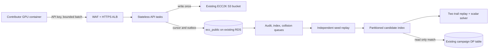

# ECC Challenges

`ecc-challenges.com` is the public contribution gateway for the ECC2K-130
distributed walk. A contributor signs in with GitHub, creates a revocable API
key, and runs one Linux/NVIDIA container per GPU. The site assigns a unique
16-bit run ID, receives fixed-width distinguished-point (DP) records, and
archives every accepted byte range before acknowledging it.

The published contributor image is
`ghcr.io/aburan28/ecc-challenges-worker:0.1.0` after the `worker-v0.1.0`
release workflow completes. Pin the resulting digest for a long-running
worker. The image contains the existing, pinned ECC2K-130 sigma GPU client;
the gateway protocol is implemented here.



## Contribute

1. Open `https://ecc-challenges.com`, sign in with GitHub, and create an API key.
   The complete key appears once. Save it in
   `~/.config/ecc-challenges/api-key` with mode `0600`.
2. Create a persistent local data directory. Give each GPU a separate one;
   never restart a run with a fresh directory while its earlier seed range is
   active.
3. Run the command shown on the dashboard. On Linux, install the NVIDIA
   Container Toolkit so Docker's `--gpus all` can expose the card. The worker
   keeps its run identity and checkpoint in the mounted data directory.

The container pauses GPU collection when the local upload spool reaches its
limit and retries with the same run ID. A server `429` or `503` is a request to
back off, not permission to discard the local file. Revoking the key stops
uploads for its runs. A key never grants direct S3 or database access.

## What an accepted upload means

The API checks framing, run ID, canonical DP32 orbit-key shape, body size,
cursor, key status, key rate and quota, and global pending capacity. It stores
the exact bytes under a checksum-bound, write-once S3 key. A successful upload
acknowledges archival and the committed cursor. It does **not** assert that
each record came from the claimed seed.

The first batch of each run is selected for independent replay. Later batches
are selected after sealing with probability 1/128. A passing first replay
opens indexing for that run; sampled and unselected states remain distinct.
All public points are kept in `ecc_public.candidate_points`, separate from the
existing campaign's authoritative table. A failed later replay suspends the
run, revokes its key, disqualifies already indexed candidate points, and
quarantines its leads. A collision lead triggers exact replay of both trails
and a pinned host solver; only a scalar independently checked against the
challenge points is a verified result.

These checks contain abuse and preserve evidence, but sparse random sampling
cannot certify every point in a batch. Quotas, queue backpressure, operator
monitoring, and exact replay of every collision lead remain essential.

## Development

```sh
uv sync --extra test
PATH=/opt/homebrew/opt/postgresql@16/bin:$PATH uv run pytest -q
aws cloudformation validate-template --template-body file://infra/foundation.yaml
aws cloudformation validate-template --template-body file://infra/service.yaml
```

The integration suite starts isolated PostgreSQL and mocked S3/SQS. It checks
key lifecycle, run assignment, upload idempotency, archival, outbox repair,
indexing, failed replay quarantine, and the HTTP worker protocol. The audit
image builds and runs the pinned arithmetic test before copying the replay
binary; its host solver is separately built from a pinned `crypto` source
commit. Source bundles and hashes are under `vendor/`.

## Deployment and capacity

See [operations](docs/operations.md) for image publishing, AWS stacks,
Squarespace DNS, GitHub OAuth setup, rollout checks, and queue alarms. See
[admission and capacity](docs/admission-and-capacity.md) for the threat model,
rate limits, and the measurable throughput gate. The capacity script accepts
observed rates:

```sh
python3 scripts/capacity.py --gpus 1000 --steps-per-gpu-second 1000000000 \
  --steps-per-dp 350000000 --index-rows-per-task-second 20000 \
  --audit-seconds-per-record 600 --new-runs-per-hour 100
```

The numbers in that command are **illustrative input**, not campaign
measurements. Releasing the site to a large fleet requires measured replay
time and a sustained arrival/drain test; this is tracked in
[the capacity problem record](problems/dp32-verifier-and-ingest-capacity.md).

## Source and campaign boundary

The contributor GPU base is the immutable image
`ghcr.io/aburan28/ecc2k130-worker@sha256:25299db686c6b73bb59edc1b5f6591d917ada4e5d933172a4eca7274a71e9421`.
The replay source is `aburan28/cryptanalysis` commit
`c8cc56d8c98705c7f84a21aae1e042453e0105e6`; the scalar resolver source
is `aburan28/crypto` commit
`79006eb85a400474e83f6a76fac0dca6b60a8b5d`.
The shared S3 seed registry is the admission authority for run IDs. The legacy
campaign table is never written by this service. The paper's quantitative
claims are governed by the paper's separate evidence and submission process.
