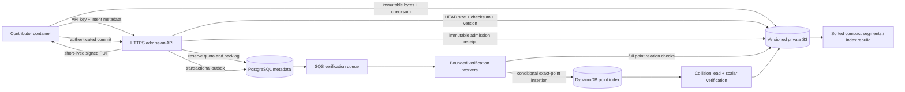

# All-curve distinguished-point storage

Implementation status: v2 is being integrated and is disabled by default. The
production ECC2K-130 v1 walk keeps its existing encoding and namespace. A catalog
entry alone never enables a worker. Historical database import is deferred.

## Scope and identities

Support covers the 24 instances in Appendix A of the [official Certicom
challenge document](https://www.certicom.com/content/dam/certicom/images/pdfs/challenge-2009.pdf):
9 prime-field and 15 binary-field instances, with actual field widths 79–359 bits.
`src/ecc_challenges/multicurve/instances.json` pins the PDF, extracted text, exact
polynomial basis, coefficients, G, Q, subgroup order and cofactor. Recorded source
normalizations are reproducible with `extract_parameters.py`. Probable-prime
checks are arithmetic admission checks, not primality certificates.

A namespace SHA-256 binds the exact instance digest, target Q, walk, DP predicate,
coefficient derivation and record codec. UUID runs and 64-bit trail IDs remove the
legacy 16-bit run allocation constraint. No record crosses namespaces, including
records for the same curve using different walks. The generic affine walk uses
32 deterministic nonzero G multiples; start coefficients use full-width SHAKE256
rejection sampling. Binary arithmetic uses the published polynomial basis.

Each record stores `trail_id:u64le | steps:u64le | x:BE | y:BE | a:BE | b:BE`,
where `R=aG+bQ`. Widths are fixed per namespace, derived from field and subgroup
sizes: 56–196 bytes for this registry. Scalars are binary, avoiding database
numeric precision limits. Finite points whose SHA-256 of canonical x||y has trailing DP bits zero qualify; the first hash byte selects the walk partition.
Generic default: 20 bits. V1 retains its original DP32 Frobenius predicate.

## Submission and processing



1. An authenticated upload intent reserves a byte quota and a backlog slot before
   issuing any S3 capability. At most one reserved intent exists at a run cursor,
   and at most eight exist per account. Intents expire after 15 minutes.
2. A signed PUT fixes object key, content length, SHA-256 checksum, content type,
   server-side encryption and `If-None-Match: *`. Contributors receive no AWS
   credentials and cannot list, read, delete or choose archive keys.
3. Commit reauthenticates the API key and run, checks the uploaded length and
   checksum with HEAD, and pins the S3 VersionId. Immutable batch and admission
   receipts describe the accepted bytes. Successful acknowledgment requires the
   admission receipt. A durable database outbox repairs interrupted queue sends.
4. A verifier checks the raw SHA-256 and namespace binding, canonical coordinates
   and scalars, DP predicate, curve equation, and **every** `R=aG+bQ` relation.
   Only fully validated batches produce verified receipts and index writes.
   A lease token guards progress and terminal updates. Retry cannot skip an
   unfinished record or use another verifier's uncommitted progress.
5. Each exact point uses a conditional DynamoDB PutItem with
   `attribute_not_exists(pk)` and `ReturnValuesOnConditionCheckFailure=ALL_OLD`.
   The prior witness is returned on a collision. This avoids a lookup/insert
   race and preserves the first immutable witness. Identical coefficient pairs
   are duplicate work; distinct pairs create deterministic collision leads.
6. A batch is indexed only after all point inserts and collision leads are
   durable. For equal points, solve `(a1-a2)/(b2-b1) mod n`, then check `dG=Q`.
   A zero denominator is recorded as degenerate. All result receipts remain in
   S3. A retry after an index insert recreates any interrupted lead.

SQS is at least once: leases, immutable object keys and idempotent records are
required. SQS depth is not an authoritative ledger. Reconciliation requeues
unfinished database rows, including messages that expired or reached a DLQ.

## Archive layout

```text
public-gateway/<stream>/v2/
  namespaces/<namespace>/manifest.json
  raw/<namespace>/shard=<sha256-prefix>/runs/<uuid>/<byte-offset>-<sha256>.bin
  batches/<namespace>/<batch-uuid>/<receipt-sha256>.json
  admissions/<namespace>/<batch-uuid>/<receipt-sha256>.json
  checkpoints/<namespace>/<batch-uuid>/<receipt-sha256>.json
  verified/<namespace>/<batch-uuid>/<receipt-sha256>.json
  collisions/<namespace>/<lead-id>/<receipt-sha256>.json
  compaction/<namespace>/<segment-id>/<receipt-sha256>.json
  segments/<namespace>/<segment-sha256>.bin
```

Raw objects and receipts use conditional writes and versioning. Service roles
have no object deletion permission. Bucket policy enforces conditional writes
for v2. S3 remains the witness archive; PostgreSQL holds account/run/cursor,
quota, processing and collision metadata. DynamoDB is a rebuildable online index.
PostgreSQL account secrets and quota history still require database backups.

Do not create one S3 object per DP. Contributors upload batches up to 1 MiB;
compaction groups verified batches into sorted segments targeting 128–256 MiB.
A segment retains the source batch UUID and record ordinal for every witness,
plus a manifest naming all source checksums and versions. Compaction never
removes raw witnesses. Lifecycle rules may move old compact segments to cheaper
storage after their minimum storage and access requirements are understood.

## Capacity, abuse and accounting

API tasks scale behind the existing HTTPS load balancer. Direct S3 upload keeps
DP bytes off web task memory and network paths. Verification and conditional
index insertion scale independently from admission. Limit in-flight work per
worker; do not submit an unbounded future per point. Autoscale against oldest
queue age and sustained backlog, and monitor verifier rate, index throttle
count, failed validation, duplicate rate, DLQs and reserved-byte utilization.

Admission stops issuing capabilities when bounded pressure pools fill and
returns Retry-After. Clients retain pending records and checkpoint state, pause
compute during failed upload, and retry with backoff. v1 and v2 have separately
bounded pressure pools; their sum is the overall maximum. Keys share an account
run cap and daily byte accounting; there is no anonymous ingestion route.

Full algebraic verification establishes a valid point relation. It does not
prove the submitted path, elapsed GPU work, independence, or claimed step count.
An attacker can still send duplicate valid witnesses; deduplication and quotas
bound their impact. Do not convert reported `steps` into verified work. Progress
percentages remain unknown until a declared work-verification and collision
model exists. Audited walk segments or unpredictable replay challenges are a
separate future scoring gate.

For capacity planning, `raw bytes/day = 86400 * DP/s * record_bytes` before
compression and replicas. Conditional index write units/day are approximately
`86400 * DP/s * write_attempts_per_DP * ceil(item_bytes/1024)`; failed conditions
and retries also consume capacity. At 10,000 DP/s, raw records alone are
48.384–169.344 decimal GB/day across current widths. This is arithmetic sizing,
not a measured ingest rate. Every-curve verification cost, provider GPU controls,
and sustained end-to-end capacity must be measured before advertising a rate.
Prewarm DynamoDB capacity and request quota increases for the intended launch
rate; on-demand mode does not guarantee an unlimited instantaneous burst.

## Required launch checks

- Exact registry validation and all ten published scalar correctness vectors.
- All 24 native CPU transitions checked against the independent Python group
  implementation, including wide limbs, identities and malformed encodings.
- The same finite controls on a real NVIDIA GPU using the published image.
- Presigned mutation rejection, quota/backlog boundaries, revoked keys and
  cross-namespace submissions, plus concurrent first-point collision controls.
- Interrupted upload/commit/verification/indexing and expired-message recovery.
- Archive-driven index reconstruction and compaction checksum verification.
- Measured sustained ingest with declared DP/s, item widths, verification rate,
  queue-age limits, duplicates, retries, cost and headroom.

Sources: [DynamoDB PutItem](https://docs.aws.amazon.com/amazondynamodb/latest/APIReference/API_PutItem.html),
[S3 conditional writes](https://docs.aws.amazon.com/AmazonS3/latest/userguide/conditional-writes.html),
[S3 HEAD checksums and versions](https://docs.aws.amazon.com/AmazonS3/latest/API/API_HeadObject.html),
[SQS delivery semantics](https://docs.aws.amazon.com/AWSSimpleQueueService/latest/SQSDeveloperGuide/standard-queues-at-least-once-delivery.html),
[DynamoDB on-demand scaling](https://docs.aws.amazon.com/amazondynamodb/latest/developerguide/on-demand-capacity-mode.html).

## Operator tools

The exact verified receipt list is an explicit bounded input, in a JSON array.
Use a role scoped to the archive and the separate rebuild table. The tool checks
its AWS account before any mutation. A rebuild checks every relation again,
preserves every collision in S3, and emits completion only after durable leads.

```sh
python -m ecc_challenges.multicurve.archive_tool compact \
  --profile ecc-challenges-new --expected-account 104186811093 \
  --bucket ecc-challenges-data-104186811093 --campaign eccp-131 \
  --verified-keys /path/to/verified-keys.json --max-input-mib 128
python -m ecc_challenges.multicurve.archive_tool rebuild \
  --profile ecc-challenges-new --expected-account 104186811093 \
  --bucket ecc-challenges-data-104186811093 --campaign eccp-131 \
  --verified-keys /path/to/verified-keys.json \
  --target-table ecc-challenges-rebuild-20261016 --max-input-mib 128
```

Provision the destination rebuild table with the same `pk` string schema.
The operator must compare complete source coverage and collision receipts
before switching a service to the rebuilt table. Account/run metadata comes
from PostgreSQL backups; the index tool does not restore OAuth or quota history.
For archives beyond one256MiB group, run disjoint explicit receipt groups against
the same destination with `--resume`; retain every group's completion receipt.

Verification workers bind the DynamoDB creation UUID (`TableId`) to a durable
PostgreSQL row on their first startup, before any batch has been indexed.
A table recreated under the same name fails this fence. Worker roles can insert
and read the binding but cannot update or delete it. Rebuilds target a separate
name; only an operator can activate a complete rebuilt generation after checking
all completion and collision receipts. Stop workers during that operation.
